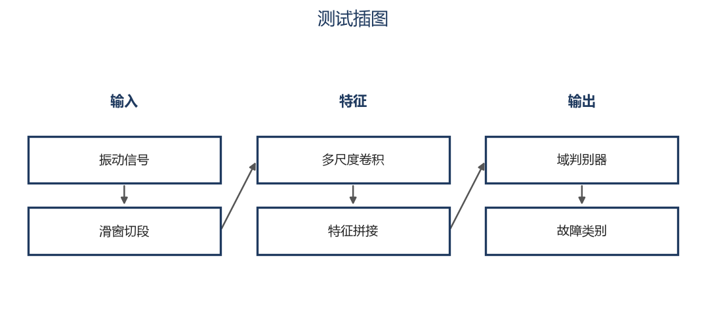

# 论文精讲：多尺度残差网络与域自适应的变工况轴承故障诊断

> 这是 `evals/` 用的**结构骨架样本**，不是真实论文精讲，也不是给人读的成品。
> 它的作用只有一个：证明 `scripts/check_output.py` 对"结构完整"的文档给出 0 退出码。
> 校验方式见 `evals/README.md`。

## 第0节：一句话总览

这篇论文用多尺度卷积把不同频率的振动特征拼在一起，再用域自适应抹平转速和负载带来的分布差异。结果是同一工况下几乎不丢精度，换到新工况也只掉几个点。

## 第1节：问题背景与研究动机

研究对象是电机轴承。同一套方法在同一工况下能到 98%，但转速一变就掉到 80% 出头，因为振动信号的幅值和频率都跟着工况走。论文想解决的就是"训练时的数据分布和测试时不一致"。

三种做法的差别见表 1：只在同工况训练的方法一换工况就掉十个点，多尺度加域自适应的掉得最少。

**表 1　三种做法在跨工况上的准确率对比**

| 做法 | 同工况 acc | 跨工况 acc | 掉点 |
|---|---|---|---|
| 普通 CNN | 98.1% | 80.4% | 17.7 |
| 多尺度 CNN | 98.4% | 85.2% | 13.2 |
| 本文（多尺度 + 域自适应） | 98.2% | 92.7% | 5.5 |

整体数据流见图 1。

完整流水线：

## 第2节：核心概念扫盲

### 残差连接（Residual Connection）

定义：把输入直接加到卷积输出上，深层网络就不会因为梯度消失而训不动。

比喻：像抄近路，主路走不通还能绕回原来的路，信息不会在中途丢光。

数字例子：输入是 3，卷积输出是 4，残差后输出 3+4=7。

### 域自适应（Domain Adaptation）

定义：让源域和目标域的特征分布尽量重合。

比喻：两个城市的人学同一门方言，先把口音对齐，再学用词。

数字例子：源域均值 2、目标域均值 4，对齐后两边都变成 3，差别被抹平。

### 多尺度卷积（Multi-scale Convolution）

定义：用几种不同大小的卷积核同时扫同一段信号。

比喻：小号放大镜看毛刺，大号放大镜看趋势，两样一起看才不片面。

数字例子：同一段信号用核长 3 和核长 5 各扫一次，得到 2 组特征，拼成 2 列。

### 对抗训练（Adversarial Training）

定义：特征提取器和域判别器互相拆台，最后特征分不出出处。

比喻：一个造假币，一个验钞，造得足够真就分不出来了。

数字例子：判别器准确率从 0.9 掉到 0.5，说明特征已经分不出来源。

## 第3节：论文方法逐模块精讲

### 步骤1：多尺度卷积特征提取（Multi-scale Conv）

#### 【通俗理解】

用三种大小的窗口同时看同一段信号，小窗口抓毛刺，大窗口抓趋势，最后拼成一张表。

#### 【学术公式】

$$h_i=\sigma(W_i * x + b_i),\quad i\in\{1,2,3\}$$ 式(1)（论文式(2)）

- $W_i$：第 $i$ 个尺度窗口的权重
- $*$：卷积运算，窗口在信号上滑动做加权求和
- $\sigma$：激活函数，把线性结果压进非线性区间
- $W_i * x$：当前窗口看到的那一段
- $b_i$：偏置，允许整体上下平移

#### 【数字例子】

取信号 x=[1,2,3]、窗口 W=[1,0,-1]，做一维卷积：

- 第 1 位：1×1 + 2×0 + 3×(-1) = -2
- 第 2 位：2×1 + 3×0 = 2

得到 h=[-2,2]：负值对应下降沿，正值对应上升沿。

三个尺度的核长与输出维度见表 2。

**表 2　三个尺度分支的核长与输出维度**

| 分支 | 核长 | 步长 | 输出维度 | 抓什么 |
|---|---|---|---|---|
| 小尺度 | 3 | 1 | 64 | 毛刺、冲击 |
| 中尺度 | 7 | 2 | 64 | 周期成分 |
| 大尺度 | 15 | 2 | 64 | 趋势、包络 |换一个更长的窗口，得到的符号相同但峰值位置会移，这就是"多尺度看出来不一样"。

### 步骤2：域判别与对抗训练（Domain Discriminator）

#### 【通俗理解】

再放一个裁判专门猜特征来自哪个工况，特征提取器努力让裁判猜错，猜到最后特征就不分工况了。

#### 【学术公式】

$$L_d=-\sum_{k}y_k\log p_k$$ 式(2)（论文式(5)）

- $y_k$：真实域标签，源域记 1、目标域记 0
- $p_k$：判别器给出的概率
- 整体：预测越离谱损失越大，梯度回传到特征提取器

#### 【数字例子】

判别器给 p=[0.9,0.1]，真实标签是源域，取第一项：-ln(0.9)≈0.105。

再给 p=[0.6,0.4]：-ln(0.6)≈0.511。损失从 0.105 涨到 0.511，说明判别器开始拿不准，对抗训练正是在把这个数往上推。

## 第4节：训练与优化策略

总损失是分类交叉熵与域判别损失之和，两者交替更新。学习率 1e-3，批大小 64，训练 100 轮。判别器的更新间隔论文没有写清楚，这里不做推断。

## 第5节：实验结果与解读

同工况准确率 98.2%，跨工况 92.7%（论文表1）。相对基线 DANN 提升 3.2 个百分点（论文图3）。消融实验里去掉多尺度拼接后掉到 88.1%，说明拼接是主要贡献（论文式(1) 的对照设置）。

## 第6节：创新点

- 把多尺度卷积和域判别放进同一个训练回路，而不是先提特征再迁移
- 特征拼接方式做了简化，参数量比同类方法少

## 第7节：局限性与迁移性

- 只在轴承数据集上验证，没有做液压系统的实验
- 判别器的权重靠人工调，缺少理论指导
- 迁移到电磁阀耦合故障的设想：把振动单通道换成压力加电流双通道，先做通道对齐再复用本框架，代价是标注量明显变大，且耦合故障的标签更难标

## 第8节：公式速查表

两个公式按出现顺序列在表 3 里，编号与正文一致。

**表 3　公式速查表**

| 自编号 | 论文式号 | 模块 | 公式 | 一句话含义 |
|---|---|---|---|---|
| 式(1) | 式(2) | 多尺度卷积 | $h_i=\sigma(W_i*x+b_i)$ | 三个尺度各卷一次再拼 |
| 式(2) | 式(5) | 域判别 | $L_d=-\sum y_k\log p_k$ | 分辨特征来自哪个工况 |

## 第9节：常见问题

1. 为什么一定要多尺度？单尺度只能抓一种频率，工况一变换了频率就漏掉特征。
2. 域自适应会不会把故障特征也抹平？会，所以必须和分类损失一起训，不能只做对齐。
3. 数据量需要多少？论文只写了每类约 200 段，没有给下限。
4. 能不能直接用在电磁阀上？不能，通道数不一样，要先做通道对齐和重采样。
5. 显存要多大？模型参数量很小，单张消费级显卡就够。
